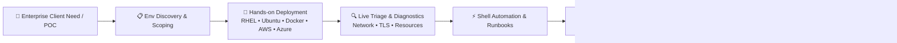

<!-- ═══════════════════════════════════════════════════════════════════════ -->
<!--                  SHABUKTAGIN PHOTON KHAN • GITHUB PROFILE               -->
<!-- ═══════════════════════════════════════════════════════════════════════ -->

<div align="center">

<a href="https://www.linkedin.com/in/shabuktaginkhan/">
  
</a>


<br/>

<p align="center">
  
  
  
  
</p>

</div>

---

<div align="right">
  <a href="https://app.daily.dev/mp5maker">
    
  </a>
</div>

## 👋 Hello World, I'm Shabuktagin Photon Khan — aka [Photon][linkedin]

### 🚀 **Solutions Engineer @ ZeuZ (North American Client Projects)**
> *Full-Stack Engineer turned Solutions Engineer, serving as the technical bridge between enterprise clients and core engineering/R&D.*

I lead hands-on technical **Proof of Concepts (POCs)** for North American enterprise clients—including tier-1 banks, telecom giants, and strategic partners. My focus is turning intricate customer environments and complex operational requirements into seamless evaluations, reliable deployments, and high-confidence commercial rollouts.

```
Client Challenge ──▶ Deep Triage ──▶ Lab Reproduction ──▶ Automation & R&D ──▶ Production Validation
```

<br clear="right"/>

---

## ⚡ Core Solutions Engineering Pillars

| Focus Area | Description & Real-World Impact |
| :--- | :--- |
| 🎯 **Enterprise POC Leadership** | Orchestrate technical evaluations from initial architecture scoping through deployment validation, steering high-value accounts toward successful adoption. |
| 🖥️ **Hands-on Deployment & Infrastructure** | Deploy and configure software across heterogeneous environments: **Red Hat Enterprise Linux (RHEL)**, **Ubuntu**, container runtimes (**Docker**, **Podman**), and cloud VMs (**AWS**, **Azure**). |
| 🔍 **Live Troubleshooting & Triage** | Unblock clients during live sessions by diagnosing networking bottlenecks, TLS/SSL certificates, disk/memory constraints, and container failures under pressure. |
| 📜 **Automation & Runbooks** | Eliminate setup friction and accelerate deployments with modular Shell/Bash automation scripts and repeatable operational runbooks. |
| 🌉 **Technical Bridge (Client ↔ R&D)** | Replicate client issues in lab environments, author detailed bug reports and engineering specifications, and validate fixes alongside QA before release. |
| 🛡️ **Technical Walkthroughs & Security Audits** | Lead interactive demos and enablement sessions for client security and IT teams—demonstrating scans and audits across networks, servers, databases, and source code. |

---

## 🔄 The Solutions Engineering Lifecycle



> **Troubleshooting Mindset:**
> `Symptom ──▶ Logs ──▶ Network ──▶ Service ──▶ Database ──▶ Configuration ──▶ Root Cause ──▶ Automated Solution`

---

## 🌐 Connect with Me

<div align="left">

<p>
  <a href="https://www.linkedin.com/in/shabuktaginkhan/"></a>
  <a href="https://react-pixie.vercel.app/"></a>
  <a href="https://photons-blog.netlify.app/"></a>
  <a href="https://khan-photon.medium.com/"></a>
  <a href="https://gitlab.com/khan.photon"></a>
  <a href="https://leetcode.com/user8791Zv/"></a>
  <a href="https://www.hackerrank.com/photonkhan"></a>
  <a href="https://www.codecademy.com/profiles/mp5maker"></a>
</p>

<p>
  <a href="https://www.codewars.com/users/mp5maker"></a>
</p>

</div>

---

## 🧰 Technical Arsenal & Tooling

<div align="left">

### 🌐 Solutions Engineering, Cloud & Infrastructure
<p>
  
  
  
  
  
  
  
  
  
</p>

### ⚙️ DevOps, CI/CD & Systems
<p>
  
  
  
  
  
  
  
</p>

### 💻 Full-Stack & Systems Engineering Foundation
<p>
  
  
  
  
  
  
  
  
  
  
  
</p>

### 🗄️ Databases & Message Brokers
<p>
  
  
  
  
  
  
</p>

### 🧪 API, Testing & Diagnostics
<p>
  
  
  
  
  
  
  
  
</p>

### 📋 Enterprise Collaboration & Tracking
<p>
  
  
  
  
  
  
</p>

</div>

---

## 📊 GitHub Analytics & Activity Statistics

<div align="center">

### 🏆 GitHub Trophies
<a href="https://github.com/mp5maker">
  
</a>

<br/><br/>

### 📈 Activity & Streak Analytics
<p align="center">
  <a href="https://github.com/mp5maker">
    
  </a>
</p>

<br/>

### ⚡ Contribution & Language Breakdown
<a href="https://github.com/mp5maker">
  
  
</a>

<br/><br/>

### 📅 Contribution Graph
<p align="center">
  
</p>

</div>

<br/>

---

<details>
  <summary>🗺️ <b>Expand Career Mindmap & Historical Highlights</b></summary>
  <br/>
  
</details>

<br/>

<div align="center">


<p><b>Bridging Enterprise Ambition with Rock-Solid Engineering ⚡</b></p>

</div>

<!-- Reference Links -->
[website]: https://react-pixie.vercel.app/
[gitlab]: https://gitlab.com/khan.photon
[linkedin]: https://www.linkedin.com/in/shabuktaginkhan/
[blog]: https://photons-blog.netlify.app/
[hackerrank]: https://www.hackerrank.com/photonkhan
[codewar]: https://www.codewars.com/users/mp5maker
[codeacademy]: https://www.codecademy.com/profiles/mp5maker
[medium]: https://khan-photon.medium.com/
[leetcode]: https://leetcode.com/user8791Zv/
